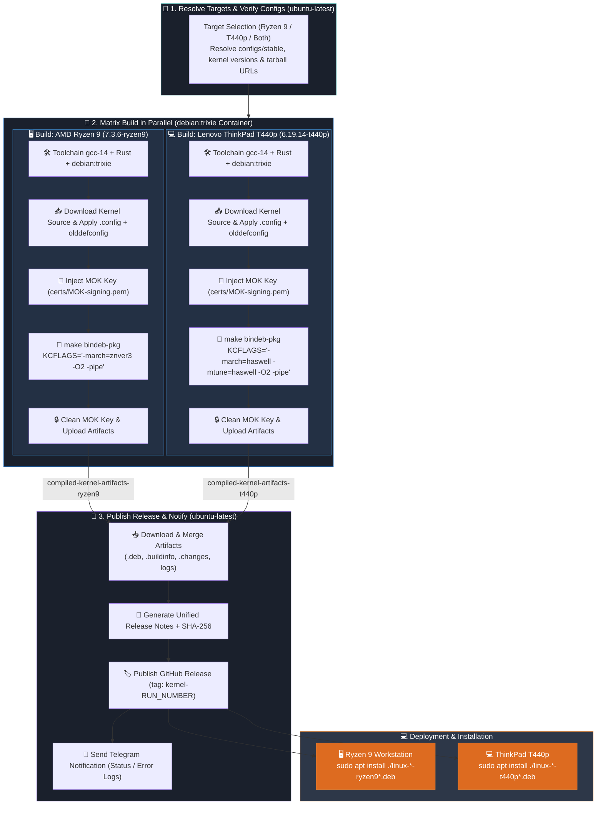

 Linux kernel
============

The Linux kernel is the core of any Linux operating system. It manages hardware,
system resources, and provides the fundamental services for all other software.

---

[](https://kernel.org/)
[](https://github.com/azagramac/linux-kernel/releases)

[](https://www.amd.com/en/products/processors/desktops/ryzen/5000-series/amd-ryzen-9-5950x.html)
[](https://www.intel.la/content/www/xl/es/products/sku/75117/intel-core-i74700mq-processor-6m-cache-up-to-3-40-ghz/specifications.html)
[](https://cdimage.debian.org/debian-cd/current/amd64/iso-dvd/)
[](https://gcc.gnu.org/gcc-14/)

---

## Last build

<p align="center">
  
  <br />
  <sub>Build for AMD Ryzen 9 5950X.</sub>
</p>

<p align="center">
  
  <br />
  <sub>Build for Lenovo ThinkPad T440p.</sub>
</p>

---

## 📂 Repository Layout & Configuration Files

| Path | Content |
| :--- | :--- |
| `configs/stable/` | Configs used by the CI by default (the newest file per device). |
| `configs/archive/` | Previous revisions kept for diffing / rollback (`6.19.14`, `7.3`, `7.3.1`, `7.3.3`, `7.3.4`, `7.3.5`; both devices). |
| `configs/base/` | Debian 13 stock configs (`6.12.107`, `6.12.113`, `6.12.118+deb13-amd64`) used as the baseline for every footprint comparison. |
| `changelogs/` | Upstream release notes per kernel version (`6.19.14`, `7.2.8`, `7.3`, `7.3.3`, `7.3.5`, `7.3.6`). |
| `patchs/debian13-ryzen9.patch` | Historical `.config` diff (Debian stock `6.12.107` → `6.19.14`); not used by the CI workflow. |
| `.github/workflows/build-kernel.yml` | Build, sign and release pipeline (see the diagram below). |

### 📌 Current `configs/stable/` contents

| Config file | Kernel | Loadable (`=m`) | Built-in (`=y`) | Total `CONFIG_` |
| :--- | :---: | :---: | :---: | :---: |
| `config-7.3.6-ryzen9-debian13` | `7.3.6` | `193` | `1,967` | `2,306` |
| `config-6.19.14-t440p-debian13` | `6.19.14` | `251` | `1,878` | `2,271` |

- The kernel version is taken from the **file name**; with `config = stable` the workflow picks the newest file per device (`sort -V`), so replacing a file in `configs/stable/` is enough to bump a target.
- The T440p is currently pinned to the `6.19.14` config; the `7.3.x` T440p configs are kept in `configs/archive/`.
- Both configs are generated with `gcc (Debian 14.2.0-19) 14.2.0`, compress modules with XZ (`CONFIG_MODULE_COMPRESS_XZ=y`) and sign them with `certs/MOK-signing.pem` (`CONFIG_MODULE_SIG_KEY`).

The counters used across this README can be reproduced with:

```bash
f=configs/stable/config-7.3.6-ryzen9-debian13
echo "m=$(grep -c '=m$' $f) y=$(grep -c '=y$' $f) total=$(grep -c '^CONFIG_' $f)"
# m=193 y=1967 total=2306
```

### ⚖️ Per-device Configuration Differences

| Area | AMD Ryzen 9 5950X (`7.3.6`) | Lenovo ThinkPad T440p (`6.19.14`) |
| :--- | :--- | :--- |
| **CPU count** | `CONFIG_NR_CPUS=32` | `CONFIG_NR_CPUS=8` |
| **NUMA** | `CONFIG_NUMA=y` (`# CONFIG_NUMA_BALANCING is not set`) | `# CONFIG_NUMA is not set` |
| **Frequency driver** | `amd-pstate` (`CONFIG_X86_AMD_PSTATE_DEFAULT_MODE=3`, active EPP) | `intel_pstate` (`CONFIG_X86_INTEL_PSTATE=y`) |
| **Default cpufreq governor** | `schedutil` | `schedutil` |
| **cpuidle governors** | `teo` + `menu` + `ladder` built (`cpuidle.governor=teo` on the cmdline) | `teo` only, with `CONFIG_INTEL_IDLE=y` |
| **GPU** | `CONFIG_DRM_AMDGPU=m` (SI/CIK off) | `CONFIG_DRM_I915=m` |
| **Graphical panic** | `CONFIG_DRM_PANIC=y` | `# CONFIG_DRM_PANIC is not set` |
| **IOMMU** | `CONFIG_AMD_IOMMU=y` | none (`# CONFIG_INTEL_IOMMU is not set`) |
| **USB Type-C** | `CONFIG_TYPEC=y` (UCSI ACPI + DP AltMode) | `# CONFIG_TYPEC is not set` |
| **KVM** | `CONFIG_KVM_AMD=m` | `CONFIG_KVM_INTEL=m` |
| **Wired / Wi-Fi** | `igb`, `igbvf`, `ixgbe`, `r8169`, `iwlwifi` | `e1000e`, `iwlwifi` (+ USB AX88179 / RTL8153 adapters) |
| **Audio** | `CA0132` (Sound Blaster Z) + HDMI (ATI) | Realtek HDA codecs + HDMI (Intel); `# CONFIG_SND_HDA_CODEC_CA0132 is not set` |
| **NVMe** | built-in (`CONFIG_BLK_DEV_NVME=y`) | module (`CONFIG_BLK_DEV_NVME=m`) |
| **FireWire** | `CONFIG_FIREWIRE=m` / `FIREWIRE_OHCI=m` / `FIREWIRE_SBP2=m` | `# CONFIG_FIREWIRE is not set` |
| **Meltdown / KPTI** | `# CONFIG_MITIGATION_PAGE_TABLE_ISOLATION is not set` | `CONFIG_MITIGATION_PAGE_TABLE_ISOLATION=y` |
| **AMD-specific mitigations** | `RETHUNK`, `UNRET_ENTRY`, `IBPB_ENTRY`, `SRSO`, `RETBLEED`, `TSA` = `y` | `# CONFIG_MITIGATION_RETHUNK is not set`, `# CONFIG_MITIGATION_RETBLEED is not set` |
| **Intel-specific mitigations** | — | `IBRS_ENTRY`, `MDS`, `TAA`, `L1TF`, `MMIO_STALE_DATA`, `SRBDS`, `GDS`, `RFDS`, `SPECTRE_BHI`, `VMSCAPE` = `y` |
| **User shadow stack (CET)** | `CONFIG_X86_USER_SHADOW_STACK=y` | `# CONFIG_X86_USER_SHADOW_STACK is not set` |
| **Platform extras** | `CONFIG_GIGABYTE_WMI=m` | `THINKPAD_ACPI`, `THINKPAD_LMI`, `SENSORS_HDAPS`, `INTEL_RAPL`, `X86_PKG_TEMP_THERMAL`, `INTEL_POWERCLAMP` |

**Shared by both configs:** `CONFIG_PREEMPT_DYNAMIC=y`, `CONFIG_HZ_1000=y`, `CONFIG_NO_HZ_IDLE=y` (`NO_HZ_FULL` off), `CONFIG_X86_NATIVE_CPU=y`, `CONFIG_CC_OPTIMIZE_FOR_PERFORMANCE=y`, BBR (`CONFIG_DEFAULT_TCP_CONG="bbr"`), MGLRU enabled, ZRAM with `lz4` (`ZSWAP` off), THP `madvise`, `CONFIG_SCHED_CORE=y` / `CONFIG_SCHED_AUTOGROUP=y`, `CONFIG_CGROUP_DMEM=y`, `CONFIG_IO_URING_ZCRX=y`, `CONFIG_MODULE_SIG_FORCE=y` (SHA-256), `CONFIG_BPF_LSM=y`, `CONFIG_STRICT_DEVMEM=y`, `kexec` compiled out, `CONFIG_DEBUG_INFO_NONE=y` and the same ftrace / kprobes / ORC diagnostics set.

---

## 📌 Project Architecture & CI/CD Workflow


---

## ⚡ Kernel Customization & Performance

> The tables and numbered sections below document the **AMD Ryzen 9 5950X** config (`config-7.3.6-ryzen9-debian13`). The **Lenovo ThinkPad T440p** config has its own section at the end of this file.

### 🧠 CPU, Architecture & Topology
| Subsystem / Option | Kconfig Option | Engineering Rationale |
| :--- | :--- | :--- |
| **Native CPU Optimization** | `CONFIG_X86_NATIVE_CPU=y` + `KCFLAGS="-march=znver3 -O2 -pipe"` | Two-layer native optimization: `X86_NATIVE_CPU` enables Kconfig host ISA feature detection; `-march=znver3` directs GCC to emit Zen 3-specific instructions (AVX2/BMI2/VAES). |
| **CPU Core Sizing** | `CONFIG_NR_CPUS=32` | Hardcapped to 32 exact threads matching Ryzen 9 5950X, eliminating virtual CPU overhead. |
| **CPU Frequency Scaling** | `amd-pstate` EPP (`CONFIG_X86_AMD_PSTATE=y` + `CONFIG_CPU_FREQ_GOV_POWERSAVE=y`) | Hardware CPPC microsecond-level core frequency and voltage scaling in active EPP mode with `powersave` and `performance` governors (`# CONFIG_X86_AMD_PSTATE_UT is not set`). |
| **NUMA Topology** | `CONFIG_NUMA=y` / `# CONFIG_NUMA_BALANCING is not set` | NUMA topology retained (`AMD_NUMA=y`, `X86_64_ACPI_NUMA=y`); automatic scan balancing disabled to eliminate overhead on single-node Ryzen systems. |
| **Core Scheduling** | `CONFIG_SCHED_CORE=y` | SMT thread isolation and core scheduling for security and hyperthreading gaming performance. |

### ⏱️ Scheduler, Latency & Ticks
| Subsystem / Option | Kconfig Option | Engineering Rationale |
| :--- | :--- | :--- |
| **Scheduler & Preemption** | `CONFIG_PREEMPT_BUILD=y` / `CONFIG_PREEMPT=y` / `CONFIG_PREEMPT_DYNAMIC=y` | Fully preemptible kernel with dynamic preemption switching for minimal input processing and audio latency. |
| **Timer Frequency** | `1000 Hz` (`CONFIG_HZ_1000=y`, `CONFIG_HZ=1000`) | High-resolution tick frequency for desktop responsiveness and precise frame pacing. |
| **Tickless Kernel** | `CONFIG_NO_HZ_IDLE=y` | Idle-tickless mode: suppresses timer interrupts on idle CPUs, reducing wakeup overhead. |
| **EEVDF Core Scheduling** | `CONFIG_SCHED_CORE=y` & `CONFIG_SCHED_AUTOGROUP=y` | High-responsiveness EEVDF scheduler with SMT core isolation and per-TTY autogrouping. `sched_ext` (SCX) and BTF are intentionally disabled to guarantee 100% clean, hang-free initramfs booting on Debian 13. |

### 🎮 GPU RDNA 2, Display & Compute (ROCm)
| Subsystem / Option | Kconfig Option | Engineering Rationale |
| :--- | :--- | :--- |
| **GPU Driver Stack** | `CONFIG_DRM_AMDGPU=m` | AMDGPU driver as loadable kernel module. Native RDNA 2 support, 16 GB Resizable BAR (ReBAR), and unlocked OverDrive power limits. |
| **AMD Display Core** | `CONFIG_DRM_AMD_DC=y` / `CONFIG_DRM_AMD_DC_FP=y` | AMD Display Core with fast-path support for DCN 3.0 (Navi 21 / RX 6950 XT). |
| **VRAM Cgroup Management**| `CONFIG_CGROUP_DMEM=y` | cgroups v2 Device Memory controller for dynamic VRAM resource allocation and priority control on `amdgpu`. |
| **USB-C & DisplayPort AltMode** | `CONFIG_TYPEC=y` / `CONFIG_TYPEC_DP_ALTMODE=m` | Built-in USB Type-C connector subsystem with UCSI ACPI and DisplayPort Alternate Mode for USB-C monitors connected directly to the RX 6950 XT. |
| **Heterogeneous Compute** | `CONFIG_HSA_AMD=y` / `CONFIG_HSA_AMD_SVM=y` / `CONFIG_DEVICE_PRIVATE=y` / `CONFIG_DRM_AMDGPU_USERPTR=y` | Native AMD KFD driver with Shared Virtual Memory (SVM) for ROCm, Vulkan, OpenCL 3.0, and direct GPU user-pointer memory access. |
| **Graphical Kernel Panic** | `CONFIG_DRM_PANIC=y` | Renders kernel panic diagnostics directly over `amdgpu` DRM output (`CONFIG_DRM_PANIC_SCREEN="user"`). |
| **Legacy Radeon Removal** | `# CONFIG_DRM_RADEON is not set` | Legacy Radeon DRM driver disabled to ensure exclusive execution of the `amdgpu` driver stack. |

### 🌐 Networking, Sockets & Congestion Control
| Subsystem / Option | Kconfig Option | Engineering Rationale |
| :--- | :--- | :--- |
| **TCP Congestion** | **TCP BBR** (`CONFIG_DEFAULT_TCP_CONG="bbr"`) | Bottleneck bandwidth RTT pacing algorithm to prevent bufferbloat and latency spikes. |
| **Targeted Network Stack** | `CONFIG_IGB=m` / `CONFIG_IXGBE=m` / `CONFIG_IWLWIFI=m` | Targeted network stack: I211 Gigabit (`igb`), 10GbE (`ixgbe` + `libie_adminq` / `libie_fwlog`), Realtek `r8169`, and AX210 Wi-Fi 6E (`iwlwifi` / `btusb`). |
| **Async Socket I/O** | `CONFIG_IO_URING_ZCRX=y` | Zero-copy packet reception for ultra-fast network socket I/O via `io_uring`. |

### 💾 Memory Management, ZRAM & Storage
| Subsystem / Option | Kconfig Option | Engineering Rationale |
| :--- | :--- | :--- |
| **Multi-Gen LRU (MGLRU)** | `CONFIG_LRU_GEN=y` / `CONFIG_LRU_GEN_ENABLED=y` | Modern multi-generational LRU page reclamation with MMU walks (`CONFIG_LRU_GEN_WALKS_MMU=y`), minimizing page thrashing and memory pressure latency. |
| **ZRAM Devices** | `CONFIG_ZRAM=y` (`CONFIG_ZRAM_DEF_COMP="lz4"`) | Compressed RAM block devices with LZ4 default compression for high-performance dynamic swap (`# CONFIG_ZSWAP is not set`). |
| **Loop & RAM Disk** | `CONFIG_BLK_DEV_LOOP=m` / `CONFIG_BLK_DEV_RAM=m` | Support for mounting ISO/disk images (`loop`) and RAM disk block devices. |
| **Hugepages & Compaction** | `THP MADVISE` (`CONFIG_TRANSPARENT_HUGEPAGE_MADVISE=y`) | Transparent Hugepages default set to `madvise` with memory compaction to avoid bloat while enabling opt-in 2MB hugepages. |

### 🔊 Audio, Multimedia & Gaming Input
| Subsystem / Option | Kconfig Option | Engineering Rationale |
| :--- | :--- | :--- |
| **Hi-Res Audio Driver** | `CONFIG_SND_HDA_CODEC_CA0132=m` | Dedicated CA0132 Sound Core3D ALSA codec module with DSP support for Sound Blaster Z 32-bit / 192 kHz audio. |
| **PlayStation Controllers**| `CONFIG_HID_PLAYSTATION=y` / `CONFIG_PLAYSTATION_FF=y` | Built-in Sony DualSense (PS5) & DualShock 4 (PS4) controller support with haptic Force Feedback over USB and Bluetooth. |
| **Virtual User Input** | `CONFIG_INPUT_UINPUT=m` | User-space `/dev/uinput` interface for input emulation, virtual gamepads, and software remapping (Steam Input). |
| **USB Webcams & Video** | `CONFIG_USB_VIDEO_CLASS=m` / `CONFIG_VIDEOBUF2_V4L2=m` | Video4Linux2 pipeline and UVC driver for USB webcams with physical evdev button support. |
| **Legacy USB Webcams (GSPCA)** | `CONFIG_USB_GSPCA=m` / `CONFIG_USB_GSPCA_OV519=m` | GSPCA framework with OV519 subdriver for legacy Sony PlayStation 2 EyeToy (OV7630/OV7648) USB webcam support. |
| **Legacy USB Controllers** | `CONFIG_USB_EHCI_HCD=m` / `OHCI` / `UHCI` | USB 2.0 and 1.1 host controller drivers for maximum legacy USB peripheral compatibility. |

### 🔐 Security, Integrity & Diagnostics
| Subsystem / Option | Kconfig Option | Engineering Rationale |
| :--- | :--- | :--- |
| **CPU Security Mitigations**| `CONFIG_CPU_MITIGATIONS=y` | Full AMD Zen 3 mitigation suite active: Spectre v1/v2, Retpoline, SRSO, Rethunk, SSB, IBPB entry, SLS, and TSA (`KPTI` disabled since AMD Zen 3 is unaffected by Meltdown). |
| **User Shadow Stack (CET)** | `CONFIG_X86_CET=y` / `CONFIG_X86_USER_SHADOW_STACK=y` | Hardware CET Shadow Stack (`CET_SS`) for user-space ROP protection on AMD Zen 3 (`# CONFIG_X86_KERNEL_IBT is not set`, as Zen 3 lacks IBT). |
| **eBPF Security (LSM)** | `CONFIG_BPF_LSM=y` / `CONFIG_BPF_JIT_ALWAYS_ON=y` | In-kernel eBPF Linux Security Module with eBPF JIT permanently enabled and unprivileged BPF disabled by default (`CONFIG_BPF_UNPRIV_DEFAULT_OFF=y`). |
| **Stack Unwinder & Tracing**| `UNWINDER_ORC=y` / `CONFIG_DEBUG_INFO_NONE=y` | Low-overhead ORC call stack unwinding with stripped debug symbols for instant initramfs boot times and zero hang risk. |
| **Module Cleanup (95.2%)** | 193 Essential Modules (`=m`) / 1,967 Built-in (`=y`) | Massive 95.2% reduction in loadable modules (`4,051 → 193`) and 25.8% reduction in built-in options (`2,651 → 1,967`) vs Debian 13 stock (`6.12.118+deb13-amd64`). Removed unused Intel/NVIDIA GPUs, unused network vendors, and TV/DVB cards. |
| **Signed Modules & Secure Boot**| `CONFIG_MODULE_SIG_FORCE=y` / `CONFIG_MODULE_SIG_ALL=y` | Mandatory cryptographic signature validation for loadable modules (`SHA-256`) and full UEFI Secure Boot compatibility via MOK. |

---

## 🛠️ Custom Kernel Optimizations & Performance Features

This custom kernel build and CI/CD pipeline are specifically tuned for **two exact machines**, both running Debian 13:

- **Workstation:** AMD Ryzen 9 5950X (Zen 3) + AMD Radeon RX 6950 XT (RDNA 2) → `configs/stable/config-7.3.6-ryzen9-debian13`
- **Laptop:** Lenovo ThinkPad T440p, Intel Core i7-4700MQ (Haswell) + Intel HD Graphics 4600 → `configs/stable/config-6.19.14-t440p-debian13`

Sections 1–8 below document the **Ryzen 9** configuration; the T440p has its own section at the end. The same approach on the T440p gives a 93.8% module reduction (`4,051 → 251`) and 29.2% fewer built-in options (`2,651 → 1,878`).

The guiding philosophy is **aggressive module & bloat removal (95.2% module reduction vs Debian 13 stock `6.12.118+deb13-amd64`, from 4,051 down to 193 essential `=m` modules, and 25.8% fewer built-in `=y` options from 2,651 down to 1,967) while retaining security, performance, and diagnostic capabilities**:
- 🔧 CPU-specific optimization (Zen 3, 32 threads, AMD pstate EPP, PREEMPT, 1000 Hz)
- 🎮 GPU-specific support (RDNA 2 / amdgpu module, ROCm SVM, VRAM cgroups, DRM panic)
- 🌐 Targeted network drivers only (Intel I211 `igb` + Intel 10GbE `ixgbe` + Intel AX210 `iwlwifi` / `btusb` + Realtek `r8169`)
- 🔐 Security retained (all AMD Zen 3 CPU mitigations, CET User Shadow Stack, BPF LSM, mandatory module signing)
- 🔍 Diagnostics retained (Ftrace, Kprobes, Uprobes, ORC)
- 🗑️ Hardware bloat removed (Intel GPU, NVIDIA, legacy Radeon, APU-only ISP/ACP, unused network vendors, legacy buses, TV/DVB)

### 📊 Stock vs Custom Kernel Footprint (`6.12.118+deb13-amd64` vs `7.3.6-ryzen9`)

| Metric | Debian 13 Stock (`6.12.118+deb13-amd64`) | Custom (`7.3.6-ryzen9`) | Difference | Reduction |
| :--- | :---: | :---: | :---: | :---: |
| **Loadable Modules (`=m`)** | `4,051` | `193` | `-3,858` | **-95.2%** |
| **Built-in Options (`=y`)** | `2,651` | `1,967` | `-684` | **-25.8%** |
| **Combined Active (`=m` + `=y`)** | `6,702` | `2,160` | `-4,542` | **-67.8%** |
| **Total Enabled (`^CONFIG_`)** | `6,901` | `2,306` | `-4,595` | **-66.6%** |

### 🚀 Kernel Crypto API Benchmark (`cryptsetup` in-memory — Ryzen 9 5950X)

Measured under identical conditions (`amd-pstate-epp` `performance` governor, THP `always`, `xts-aes-vaes-avx2`, 10 s per multi-thread run):

| Benchmark | Debian 13 Stock (`6.12.118+deb13-amd64`) | Custom (`7.3.6-ryzen9`) | Delta | Gain |
| :--- | :---: | :---: | :---: | :---: |
| **AES-XTS-256 (1 thread, Encrypt)** | `5,169.7 MiB/s` | `5,550.0 MiB/s` | `+380.3 MiB/s` | **+7.4%** |
| **AES-XTS-256 (1 thread, Decrypt)** | `5,155.4 MiB/s` | `5,542.6 MiB/s` | `+387.2 MiB/s` | **+7.5%** |
| **AES-XTS-512 (1 thread, Encrypt)** | `4,844.6 MiB/s` | `5,154.4 MiB/s` | `+309.8 MiB/s` | **+6.4%** |
| **AES-XTS-512 (1 thread, Decrypt)** | `4,829.1 MiB/s` | `5,145.1 MiB/s` | `+316.0 MiB/s` | **+6.5%** |
| **AES-XTS-256 (32 threads, Encrypt)** | `78.5 GiB/s` | `84.0 GiB/s` | `+5.5 GiB/s` | **+7.0%** |
| **AES-XTS-256 (32 threads, Decrypt)** | `78.1 GiB/s` | `83.8 GiB/s` | `+5.7 GiB/s` | **+7.3%** |
| **AES-XTS-512 (32 threads, Encrypt)** | `72.3 GiB/s` | `75.9 GiB/s` | `+3.6 GiB/s` | **+5.0%** |
| **AES-XTS-512 (32 threads, Decrypt)** | `72.1 GiB/s` | `76.0 GiB/s` | `+3.9 GiB/s` | **+5.4%** |
| **PBKDF2-SHA256 (1 thread)** | `8,533,680 it/s` | `8,603,700 it/s` | `+70,020 it/s` | **+0.8%** |
| **Argon2id LUKS (4T / 32T, 10 s)** | `77 / 91 iter` | `76 / 91 iter` | `~0` *(RAM-bound)* | — |
| **Average / Peak Frequency** | `4,161 / 5,013 MHz` | `4,150 / 5,054 MHz` | `-11 / +41 MHz` | — |
| **Peak Temperature** | `54.2 °C` | `53.1 °C` | `-1.1 °C` | **Cooler** |

### 🧹 1. Hardware Trimming & Bloat Elimination
- **Non-AMD CPU Support Removed**: Disabled Intel, Hygon, Centaur, and Zhaoxin CPU support (`# CONFIG_CPU_SUP_INTEL is not set`, etc.) to streamline kernel execution paths.
- **Unused GPU Drivers Removed**: Disabled Intel i915 (`# CONFIG_DRM_I915 is not set`) and Nvidia Nouveau (`# CONFIG_DRM_NOUVEAU is not set`).
- **Legacy AMDGPU Generations Removed**: Disabled legacy Southern Islands (`SI`) and Sea Islands (`CIK`) support (`# CONFIG_DRM_AMDGPU_SI is not set`, `# CONFIG_DRM_AMDGPU_CIK is not set`), eliminating `si_support` / `cik_support` parameter warnings in `dmesg`.
- **Targeted Wireless & Network Drivers**: Kept **`iwlwifi`** (Intel AX210), **`igb`** (Intel I211 Gigabit) and **`ixgbe`** (Intel 10GbE), plus the Realtek **`r8169`** Ethernet module (`CONFIG_R8169=m`); Broadcom, Atheros, Ralink and Realtek wireless drivers are stripped.
- **AMD IOMMU Isolation**: Native AMD Vi IOMMU driver enabled (`CONFIG_AMD_IOMMU=y`), while disabling unused Intel DMAR overhead (`# CONFIG_INTEL_IOMMU is not set`).
- **Legacy Radeon Driver Disabled**: Legacy Radeon DRM driver disabled (`# CONFIG_DRM_RADEON is not set`), ensuring exclusive `amdgpu` driver stack execution.
- **Legacy Controllers & Buses**: Removed floppy (`# CONFIG_BLK_DEV_FD is not set`), parallel ports (`# CONFIG_PARPORT is not set`), PCMCIA/CardBus (`# CONFIG_PCCARD is not set`), ISDN, and analog modems, while **keeping FireWire (IEEE1394) as modules** (`CONFIG_FIREWIRE=m`, `CONFIG_FIREWIRE_OHCI=m`, `CONFIG_FIREWIRE_SBP2=m`) and retaining legacy USB host controllers (`CONFIG_USB_EHCI_HCD=m`, `CONFIG_USB_OHCI_HCD=m`, `CONFIG_USB_UHCI_HCD=m`) for full legacy USB 1.1/2.0 device compatibility.
- **DVB & TV Capture Removal**: Disabled DVB digital/analog TV, SDR radio, and PCI capture cards (`# CONFIG_MEDIA_DIGITAL_TV_SUPPORT is not set`, `# CONFIG_MEDIA_PCI_SUPPORT is not set`), while preserving USB webcam support (`CONFIG_USB_VIDEO_CLASS=m`, `CONFIG_UVC_COMMON=m`, `VIDEOBUF2`) and legacy GSPCA webcams (`CONFIG_USB_GSPCA=m`, `CONFIG_USB_GSPCA_OV519=m` for Sony PS2 EyeToy).

### ⏱️ 2. Low-Latency Tuning (Gaming & High-Res Audio)
- **Full Preemption**: Full preemptible kernel (`CONFIG_PREEMPT_BUILD=y`, `CONFIG_PREEMPT=y`) for immediate task response and minimal audio/input latency.
- **Timer Frequency (1000 Hz)**: Set timer frequency to `1000 Hz` (`CONFIG_HZ_1000=y`, `CONFIG_HZ=1000`) for precise event timing.
- **Tickless Idle (`NO_HZ_IDLE`)**: Idle-tickless kernel (`CONFIG_NO_HZ_IDLE=y`) suppressing timer interrupts on idle CPUs, reducing wakeup overhead. Full tickless mode (`NO_HZ_FULL`) is intentionally not enabled to avoid scheduler complexity on this configuration.
- **Hi-Res Audio Driver**: Dedicated Sound Blaster Z ALSA driver (`snd_ca0132` / Sound Core3D) configured for 32-bit / 192 kHz low-jitter audio.
- **PlayStation DualSense & DualShock 4**: Built-in Sony PlayStation HID driver (`CONFIG_HID_PLAYSTATION=y`, `CONFIG_PLAYSTATION_FF=y`) with full haptic Force Feedback for PS4/PS5 gamepads over USB and Bluetooth.
- **Virtual User Input (`uinput`)**: Enabled `CONFIG_INPUT_UINPUT=m` for user-space input emulation (Steam Input, virtual gamepads, software controller remapping).
- **Legacy USB Webcam (GSPCA/OV519)**: Enabled `CONFIG_USB_GSPCA=m` and `CONFIG_USB_GSPCA_OV519=m` for Sony PlayStation 2 EyeToy (OV7630/OV7648 sensor) support via the Video4Linux2 GSPCA framework.

### 🧠 3. CPU Optimizations (AMD Ryzen 9 5950X — 16C / 32T)
- **Native Architecture Compilation — two-layer optimization**:
  - `CONFIG_X86_NATIVE_CPU=y` — instructs Kconfig to probe the build host CPU and enable matching kernel features (e.g., VAES, AVX2 crypto paths, AMD-specific code paths).
  - `KCFLAGS="-march=znver3 -O2 -pipe"` (with `KCPPFLAGS="-march=znver3 -mtune=znver3"`) — instructs GCC to emit Zen 3-specific instructions throughout the build. Set in the CI workflow (`make bindeb-pkg KCFLAGS="-march=znver3 -O2 -pipe" KCPPFLAGS="-march=znver3 -mtune=znver3"`).
  - Both flags are complementary and required for full native optimization; neither alone is sufficient.
- **Core Scheduling**: Hardware SMT core scheduling enabled (`CONFIG_SCHED_CORE=y`) for thread isolation, security, and hyperthreading gaming performance.
- **Sized Core Count**: Sized to `CONFIG_NR_CPUS=32` matching exact hardware threads, removing virtual CPU overhead.
- **AMD P-State Driver**: Native `amd-pstate` CPPC driver in active EPP mode (`CONFIG_X86_AMD_PSTATE=y`, `CONFIG_X86_AMD_PSTATE_DEFAULT_MODE=3`) with `CONFIG_CPU_FREQ_GOV_POWERSAVE=y` and `CONFIG_CPU_FREQ_GOV_PERFORMANCE=y` for full dynamic EPP scaling (`# CONFIG_X86_AMD_PSTATE_UT is not set` in production).
- **NUMA Infrastructure**: NUMA support is retained (`CONFIG_NUMA=y`, `CONFIG_AMD_NUMA=y`, `CONFIG_X86_64_ACPI_NUMA=y`) for correct hardware topology detection. Automatic NUMA balancing (`# CONFIG_NUMA_BALANCING is not set`) is disabled to eliminate background memory scan overhead on this single-node Ryzen system.
- **High-Responsiveness EEVDF Scheduler**: Official Linux mainline EEVDF CPU scheduler tuned with `1000 Hz` tick rate (`CONFIG_HZ_1000=y`), `PREEMPT_DYNAMIC=y`, and interactive autogrouping (`CONFIG_SCHED_AUTOGROUP=y`). Note: `sched_ext` (SCX) and heavy BTF typeinfo are intentionally omitted (`CONFIG_DEBUG_INFO_NONE=y`) in production to completely eliminate initramfs hangs and boot stalls in Debian 13.

### 🎮 4. GPU & Display Core (Radeon RX 6950 XT / Navi 21)
- **AMDGPU as Module**: `CONFIG_DRM_AMDGPU=m` — the AMDGPU driver is a loadable kernel module, not built into the kernel image. This is the standard Debian/upstream configuration for GPU drivers.
- **Display Core (DCN 3.0)**: AMD Display Core enabled (`CONFIG_DRM_AMD_DC=y`) with fast-path support (`CONFIG_DRM_AMD_DC_FP=y`) and Secure Display (`CONFIG_DRM_AMD_SECURE_DISPLAY=y`), optimized for Navi 21 / RDNA 2 architecture (DCN 3.0). APU-only blocks (`# CONFIG_DRM_AMD_ISP is not set`, `# CONFIG_DRM_AMD_ACP is not set`) and `# CONFIG_DRM_AMDGPU_WERROR is not set` are disabled.
- **USB Type-C & DisplayPort AltMode**: Native Type-C subsystem (`CONFIG_TYPEC=y`, `CONFIG_USB_COMMON=y`) with UCSI ACPI driver (`CONFIG_TYPEC_UCSI=y`, `CONFIG_UCSI_ACPI=y`) and DisplayPort Alternate Mode module (`CONFIG_TYPEC_DP_ALTMODE=m`) enabling direct USB-C monitor connectivity with zero video delay on boot.
- **Heterogeneous Compute (ROCm / KFD + SVM)**: AMD HSA kernel driver (`CONFIG_HSA_AMD=y`) with Shared Virtual Memory (`CONFIG_DEVICE_PRIVATE=y`, `CONFIG_HSA_AMD_SVM=y`) enabled for ROCm, Vulkan, and OpenCL compute.
- **Direct GPU Memory Access**: `CONFIG_DRM_AMDGPU_USERPTR=y` allowing GPU direct access to user space memory pointers.
- **Graphical Kernel Panic**: `CONFIG_DRM_PANIC=y` (`CONFIG_DRM_PANIC_SCREEN="user"`) renders panic output directly on DRM displays.
- **Resizable BAR & OverDrive**: Full 16 GB VRAM BAR access and OverDrive power limit unlocking (`amdgpu.ppfeaturemask=0xffffffff`).
- **VRAM Cgroup Management (`CONFIG_CGROUP_DMEM=y`)**: Enabled cgroups v2 Device Memory controller for `amdgpu`, allowing dynamic VRAM priority allocation (`dmemcg-booster`) to eliminate stutter under heavy VRAM pressure.

### 🌐 5. Networking & Congestion Control
- **TCP BBR Default**: Configured with **TCP BBR** as the default congestion control algorithm (`CONFIG_DEFAULT_TCP_CONG="bbr"`, `CONFIG_DEFAULT_BBR=y`). Eliminates bufferbloat and maximizes bandwidth throughput.
- **Targeted Network Stack**: Includes Intel I211 (`igb`), Intel 10GbE (`ixgbe`), Realtek `r8169`, and Intel AX210 Wi-Fi 6E / Bluetooth 5.3 (`iwlwifi` / `btusb`).
- **eBPF JIT & LSM**: JIT compiler permanently enabled (`CONFIG_BPF_JIT=y`, `CONFIG_BPF_JIT_DEFAULT_ON=y`, `CONFIG_BPF_JIT_ALWAYS_ON=y`) alongside eBPF Security Module (`CONFIG_BPF_LSM=y`) and unprivileged BPF disabled by default (`CONFIG_BPF_UNPRIV_DEFAULT_OFF=y`) for zero-overhead security hooks.
- **`IO_URING_ZCRX`**: Zero-copy network reception (`CONFIG_IO_URING_ZCRX=y`) enabled for ultra-fast socket I/O.

### 💾 6. Memory Tuning (MGLRU, ZRAM & Loop)
- **Multi-Gen LRU (MGLRU)**: Multi-Generational Least Recently Used page reclamation (`CONFIG_LRU_GEN=y`, `CONFIG_LRU_GEN_ENABLED=y`, `CONFIG_LRU_GEN_WALKS_MMU=y`). Replaces legacy two-tier page reclamation with high-performance generational aging and page-table scanning, drastically reducing reclaim latency and memory thrashing under heavy loads.
- **ZRAM Compressed RAM Devices**: Built-in `CONFIG_ZRAM=y` with LZ4 default compression (`CONFIG_ZRAM_DEF_COMP="lz4"`) for compressed swap/RAM block devices. `Zswap` is intentionally disabled (`# CONFIG_ZSWAP is not set`).
- **Loop & RAM Disk Devices**: `CONFIG_BLK_DEV_LOOP=m` and `CONFIG_BLK_DEV_RAM=m` enabled for mounting disk images and loopback/RAM devices.
- **Transparent Hugepages (`madvise`)**: Set THP default to `madvise` (`CONFIG_TRANSPARENT_HUGEPAGE_MADVISE=y`) alongside memory compaction (`CONFIG_COMPACTION=y`) to prevent system-wide memory bloat while enabling 2MB hugepages for opt-in applications (games, emulators, KVM).

### 🔐 7. CPU Security & Mitigations (Zen 3 / x86_64)

This kernel is **not** a "performance at all costs" build — all applicable AMD Zen 3 CPU security mitigations are retained:

- **CPU Mitigations Enabled**: Full AMD Zen 3 mitigation suite active (`CONFIG_CPU_MITIGATIONS=y`), including Spectre v1/v2, Retpoline (`CONFIG_MITIGATION_RETPOLINE=y`), Rethunk (`CONFIG_MITIGATION_RETHUNK=y`), SRSO (`CONFIG_MITIGATION_SRSO=y`), SSB (`CONFIG_MITIGATION_SSB=y`), IBPB entry (`CONFIG_MITIGATION_IBPB_ENTRY=y`), SLS (`CONFIG_MITIGATION_SLS=y`), and TSA (`CONFIG_MITIGATION_TSA=y`).
- **User Shadow Stack (CET)**: Hardware-enforced Shadow Stack enabled (`CONFIG_X86_CET=y`, `CONFIG_X86_USER_SHADOW_STACK=y`) for user-space ROP protection (`CET_SS` verified in silicon on Ryzen 9 5950X; `# CONFIG_X86_KERNEL_IBT is not set` since Zen 3 lacks IBT).
- **No Unnecessary Meltdown KPTI Overhead on Zen 3**: `# CONFIG_MITIGATION_PAGE_TABLE_ISOLATION is not set` on the Ryzen 9 config (AMD Zen 3 is architecturally unaffected by Meltdown), whereas KPTI **remains enabled** (`CONFIG_MITIGATION_PAGE_TABLE_ISOLATION=y`) on the Intel Haswell ThinkPad T440p config.
- **Kernel Hardening**: `kexec` compiled out (`# CONFIG_KEXEC is not set`), mandatory signed modules (`CONFIG_MODULE_SIG_FORCE=y`), strict `/dev/mem` (`CONFIG_STRICT_DEVMEM=y`, `CONFIG_IO_STRICT_DEVMEM=y`), and eBPF LSM (`CONFIG_BPF_LSM=y`, `CONFIG_BPF_UNPRIV_DEFAULT_OFF=y`).

The security philosophy is **hardware/driver bloat removal** — not security regression.

### 🔬 8. Diagnostics, Tracing & Observability

> `CONFIG_DEBUG_KERNEL=y` is set intentionally. This enables the diagnostic/tracing infrastructure **without** heavyweight runtime overhead — KASAN, KFENCE, SLUB_DEBUG, DEBUG_VM, and lock validators are **not** set.

The project removes unnecessary runtime hardware support while deliberately retaining the infrastructure needed to diagnose and profile the system (`ftrace`, `perf`, `blktrace`, ORC unwinding, and hung-task/lockup detection):

#### 🔍 Kernel Debug & Fast Initramfs Boot
```text
CONFIG_DEBUG_KERNEL=y
CONFIG_DEBUG_MISC=y
CONFIG_DEBUG_INFO_NONE=y
CONFIG_DYNAMIC_DEBUG=y
CONFIG_DYNAMIC_DEBUG_CORE=y
CONFIG_BLK_DEV_IO_TRACE=y
```
`CONFIG_DEBUG_INFO_NONE=y` strips debug symbols and heavy BTF typeinfo from loadable modules, avoiding initramfs parsing stalls and keeping boot times fast on Debian 13.

#### 📊 Scheduler Diagnostics
```text
CONFIG_SCHED_INFO=y
CONFIG_SCHEDSTATS=y
CONFIG_LOCK_DEBUGGING_SUPPORT=y
```
Heavy lock validation facilities are disabled:
```text
# CONFIG_PROVE_LOCKING is not set
# CONFIG_LOCK_STAT is not set
# CONFIG_DEBUG_SPINLOCK is not set
# CONFIG_DEBUG_MUTEXES is not set
# CONFIG_DEBUG_ATOMIC_SLEEP is not set
```

#### 🔎 Ftrace & Event Probes
```text
CONFIG_FTRACE=y
CONFIG_FUNCTION_TRACER=y
CONFIG_FUNCTION_GRAPH_TRACER=y
CONFIG_DYNAMIC_FTRACE=y
CONFIG_DYNAMIC_FTRACE_WITH_REGS=y
CONFIG_DYNAMIC_FTRACE_WITH_DIRECT_CALLS=y
CONFIG_DYNAMIC_FTRACE_WITH_ARGS=y
CONFIG_STACK_TRACER=y
CONFIG_FTRACE_SYSCALLS=y
CONFIG_KPROBE_EVENTS=y
CONFIG_UPROBE_EVENTS=y
CONFIG_BPF_EVENTS=y
CONFIG_DYNAMIC_EVENTS=y
```

#### 🧭 ORC Unwinder & 🚨 Hung Task / Lockup Detection
```text
CONFIG_UNWINDER_ORC=y
# CONFIG_UNWINDER_FRAME_POINTER is not set
CONFIG_LOCKUP_DETECTOR=y
CONFIG_SOFTLOCKUP_DETECTOR=y
CONFIG_HARDLOCKUP_DETECTOR=y
CONFIG_DETECT_HUNG_TASK=y
CONFIG_DEFAULT_HUNG_TASK_TIMEOUT=120
```

---

## 🔍 Post-Boot Verification (AMD Ryzen 9)

After booting into the custom kernel, verify active optimizations using the following commands.

#### Kernel version
```bash
$ uname -a
Linux ryzen 7.3.6-ryzen9 #ryzen9 SMP PREEMPT_DYNAMIC Mon Nov 23 17:22:13 CET 2026 x86_64 GNU/Linux
```

#### CPU topology
```bash
$ lscpu | grep -E "Model name|Thread\(s\) per core|CPU\(s\):"
CPU(s):                32
Thread(s) per core:    2
Model name:            AMD Ryzen 9 5950X 16-Core Processor
```

#### AMD P-State
```bash
$ cat /sys/devices/system/cpu/cpu0/cpufreq/scaling_driver
amd-pstate-epp
```

#### Preemption
```bash
$ sudo dmesg | grep -i "preempt"
[    0.032333] Dynamic Preempt: full
[    0.032388] rcu: Preemptible hierarchical RCU implementation.
```
> `CONFIG_PREEMPT_BUILD=y`, `CONFIG_PREEMPT=y`, `CONFIG_PREEMPT_DYNAMIC=y`

#### NO_HZ
```bash
$ grep -E "CONFIG_NO_HZ_(IDLE|FULL)" /boot/config-$(uname -r)
CONFIG_NO_HZ_IDLE=y
# CONFIG_NO_HZ_FULL is not set
```

#### RCU
```bash
$ grep -E "CONFIG_RCU_(BOOST|NOCB_CPU)" /boot/config-$(uname -r)
```
No output expected — `RCU_BOOST` and `RCU_NOCB_CPU` are not set in this configuration.

#### TCP BBR
```bash
$ cat /proc/sys/net/ipv4/tcp_congestion_control
bbr
```

#### Multi-Gen LRU (MGLRU)
```bash
$ cat /sys/kernel/mm/lru_gen/enabled
0x0007
```
> `0x0007` indicates all components of Multi-Gen LRU are active (kswapd, direct reclaim, page-table walks).

#### Resizable BAR (ReBAR)
```bash
$ sudo dmesg | grep -i "Detected VRAM"
[drm] Detected VRAM RAM=16368M, BAR=16384M
```
> Confirms full 16 GB Resizable BAR active on AMD Radeon RX 6950 XT.

#### ZRAM
```bash
$ grep -E "CONFIG_ZRAM($|_DEF_COMP)|CONFIG_ZSWAP" /boot/config-$(uname -r)
# CONFIG_ZSWAP is not set
CONFIG_ZRAM=y
CONFIG_ZRAM_DEF_COMP="lz4"
```

#### AMDGPU
```bash
$ sudo dmesg | grep -i amdgpu | head -30
[    0.000000] Command line: BOOT_IMAGE=/vmlinuz-7.3.6-ryzen9 root=/dev/mapper/debian_crypt-root ro amdgpu.ppfeaturemask=0xffffffff efi=nodbx cpuidle.governor=teo
[    0.009148] Kernel command line: BOOT_IMAGE=/vmlinuz-7.3.6-ryzen9 root=/dev/mapper/debian_crypt-root ro amdgpu.ppfeaturemask=0xffffffff efi=nodbx cpuidle.governor=teo
[    4.859534] amdgpu: unknown parameter 'si_support' ignored
[    4.860323] amdgpu: unknown parameter 'cik_support' ignored
[    4.866799] amdgpu: Virtual CRAT table created for CPU
[    4.867606] amdgpu: Topology: Add CPU node
[    4.868422] amdgpu: Overdrive is enabled, please disable it before reporting any bugs unrelated to overdrive.
[    4.869268] amdgpu 0000:0d:00.0: enabling device (0006 -> 0007)
[    4.870087] amdgpu 0000:0d:00.0: initializing kernel modesetting (SIENNA_CICHLID 0x1002:0x73A5 0x1002:0x0E3A 0xC0).
[    4.870907] amdgpu 0000:0d:00.0: register mmio base: 0xFC900000
[    4.871664] amdgpu 0000:0d:00.0: register mmio size: 1048576
[    4.876104] amdgpu 0000:0d:00.0: detected ip block number 0 <common_v1_0_0> (nv_common)
[    4.876820] amdgpu 0000:0d:00.0: detected ip block number 1 <gmc_v10_0_0> (gmc_v10_0)
[    4.877510] amdgpu 0000:0d:00.0: detected ip block number 2 <ih_v5_0_0> (navi10_ih)
[    4.878172] amdgpu 0000:0d:00.0: detected ip block number 3 <psp_v11_0_0> (psp)
[    4.878825] amdgpu 0000:0d:00.0: detected ip block number 4 <smu_v11_0_0> (smu)
[    4.879470] amdgpu 0000:0d:00.0: detected ip block number 5 <dce_v1_0_0> (dm)
[    4.880098] amdgpu 0000:0d:00.0: detected ip block number 6 <gfx_v10_0_0> (gfx_v10_0)
[    4.880712] amdgpu 0000:0d:00.0: detected ip block number 7 <sdma_v5_2_0> (sdma_v5_2)
[    4.881301] amdgpu 0000:0d:00.0: detected ip block number 8 <vcn_v3_0_0> (vcn_v3_0)
[    4.881866] amdgpu 0000:0d:00.0: detected ip block number 9 <jpeg_v3_0_0> (jpeg_v3_0)
[    4.882420] amdgpu 0000:0d:00.0: Fetched VBIOS from VFCT
[    4.882943] amdgpu 0000:0d:00.0: [drm] ATOM BIOS: 113-D4124100-102, build: 604554  , ver: 020.001.000.071.018202, 2022/03/10
[    4.885161] amdgpu 0000:0d:00.0: vgaarb: deactivate vga console
[    4.885165] amdgpu 0000:0d:00.0: Trusted Memory Zone (TMZ) feature disabled as experimental (default)
[    4.885199] amdgpu 0000:0d:00.0: MEM ECC is not presented.
[    4.885205] amdgpu 0000:0d:00.0: SRAM ECC is not presented.
[    4.885215] amdgpu 0000:0d:00.0: vm size is 262144 GB, 4 levels, block size is 9-bit, fragment size is 9-bit
[    4.885226] amdgpu 0000:0d:00.0: VRAM: 16368M 0x0000008000000000 - 0x00000083FEFFFFFF (16368M used)
[    4.885232] amdgpu 0000:0d:00.0: GART: 512M 0x0000000000000000 - 0x000000001FFFFFFF
```
> The `si_support`/`cik_support` "ignored" warnings confirm that legacy SI/CIK support is correctly disabled in the config (`# CONFIG_DRM_AMDGPU_SI is not set`). VRAM: **16368M** with full ReBAR mapping.

#### Device Memory Cgroup
```bash
$ grep CONFIG_CGROUP_DMEM /boot/config-$(uname -r)
CONFIG_CGROUP_DMEM=y
```

#### BPF JIT
```bash
$ grep -E "CONFIG_BPF_JIT" /boot/config-$(uname -r)
CONFIG_BPF_JIT=y
CONFIG_BPF_JIT_ALWAYS_ON=y
CONFIG_BPF_JIT_DEFAULT_ON=y
```

#### USB Type-C & UCSI
```bash
$ ls -l /sys/class/typec/
```
> Shows registered Type-C connector ports and UCSI status for USB-C monitors and peripherals.

#### ORC Unwinder
```bash
$ grep CONFIG_UNWINDER_ORC /boot/config-$(uname -r)
CONFIG_UNWINDER_ORC=y
```

---

## 🧪 Kernel Configuration Verification (AMD Ryzen 9)

The configuration embedded in the installed kernel can be extracted directly from the Debian package:

```bash
$ dpkg-deb --fsys-tarfile linux-image-7.3.6-ryzen9_*.deb \
  | tar -x ./boot/config-7.3.6-ryzen9 -O \
  | grep -E "CONFIG_(X86_NATIVE_CPU|NR_CPUS|PREEMPT|NO_HZ|BPF_JIT|CGROUP_DMEM|DRM_AMDGPU|HSA_AMD|TYPEC)"
CONFIG_NO_HZ_IDLE=y
CONFIG_PREEMPT_BUILD=y
CONFIG_PREEMPT=y
CONFIG_PREEMPT_DYNAMIC=y
CONFIG_BPF_JIT=y
CONFIG_BPF_JIT_ALWAYS_ON=y
CONFIG_BPF_JIT_DEFAULT_ON=y
CONFIG_NR_CPUS=32
CONFIG_X86_NATIVE_CPU=y
CONFIG_DRM_AMDGPU=m
CONFIG_HSA_AMD=y
CONFIG_CGROUP_DMEM=y
```

This allows the packaged kernel to be verified independently of the source-tree configuration.

---

## 🔏 Secure Boot & MOK (Machine Owner Key) Enrollment

Both custom kernel variants (`-ryzen9` and `-t440p`) are cryptographically signed during the build pipeline (`CONFIG_MODULE_SIG=y`, `CONFIG_MODULE_SIG_ALL=y`, `CONFIG_SYSTEM_TRUSTED_KEYRING=y`). All compiled kernel modules (`.ko`) are signed with a private **Machine Owner Key (MOK)**.

This ensures full compatibility with **UEFI Secure Boot**, preventing unsigned or tampered code from loading into kernel space while maintaining an unbroken chain of trust.

### 🔑 MOK Key Artifacts Overview

| File | Format | Purpose | Required for Compilation? | Enrolled in UEFI? |
| :--- | :--- | :--- | :---: | :---: |
| **`MOK.pem`** | PEM (ASCII) | Public certificate corresponding to the MOK signing key. | **No** | No |
| **`MOK-signing.pem`** | PEM (ASCII) | Private key used by `scripts/sign-file` during `make bindeb-pkg`. | **Yes** (injected from GitHub Secret `MOK_SIGNING_PEM`) | No |
| **`MOK.der`** | DER (Binary) | Public certificate in binary X.509 format for UEFI Shim / `mokutil`. | **No** | **Yes** (one-time enrollment) |
| **`MOK.priv`** | PEM / Raw | Local master private key used to generate the signing key pair. | **No** (kept securely offline) | No |

---

### 🖥️ Step-by-Step: Enrolling the MOK Key in UEFI/BIOS with `mokutil`

To boot the signed kernel on any target machine (Workstation AMD Ryzen 9 or Lenovo ThinkPad T440p) with **UEFI Secure Boot enabled**, you must enroll the public certificate `MOK.der` once in the system's Shim MOK database.

#### Step 1: Copy `MOK.der` to the Target Machine
Transfer the `MOK.der` binary certificate to the target workstation or laptop (e.g., via SCP, USB flash drive, or local network share).

#### Step 2: Register the Key with `mokutil`
Execute the enrollment request command with root privileges:

```bash
sudo mokutil --import /path/to/MOK.der
```

You will be prompted to enter and confirm a **one-time password** (e.g., `12345678`). This temporary password is only used once during the subsequent reboot to authorize the enrollment in firmware.

#### Step 3: Reboot the System
```bash
sudo reboot
```

#### Step 4: Confirm Enrollment in the Shim UEFI Screen (*MOK Management*)
When the machine reboots, the blue **Shim UEFI key management screen** will appear before GRUB:

1. **Press any key** within 10 seconds to enter the MOK management menu.
2. Select **`Enroll MOK`** and press `Enter`.
3. Select **`View key 0`** (optional) to review the certificate details (Issuer, Fingerprint, Validity).
4. Select **`Continue`**.
5. When prompted *"Enroll the key(s)?"*, select **`Yes`**.
6. **Enter the temporary password** you created in Step 2.
7. Select **`Reboot`**.

The machine will reboot normally into your signed custom Linux kernel.

---

### 🔍 Verification Commands

After booting into Linux, you can verify that Secure Boot and the MOK key are active and functional:

```bash
# 1. Check Secure Boot status
$ mokutil --sb-state
SecureBoot enabled

# 2. Verify that your MOK certificate is enrolled
$ mokutil --test-key /path/to/MOK.der
/path/to/MOK.der is already enrolled

# 3. List all enrolled keys in the MOK database
$ mokutil --list-enrolled | grep -E "(Issuer|Subject|Serial)"

# 4. Check kernel dmesg for the loaded MOK certificate in the system keyring
$ sudo dmesg | grep -Ei "certificate|keyring|asymmetric"
[    0.912450] Loading compiled-in X.509 certificates
[    0.913012] Loaded X.509 cert 'Custom MOK: ...'
```

---

### 🐧 Kernel and Toolchain
| Element             | AMD Ryzen 9 5950X | Lenovo ThinkPad T440p |
| ------------------- | ----------------- | --------------------- |
| Kernel              | `7.3.6-ryzen9`    | `6.19.14-t440p`       |
| Config              | `configs/stable/config-7.3.6-ryzen9-debian13` | `configs/stable/config-6.19.14-t440p-debian13` |
| Model               | SMP PREEMPT_DYNAMIC | SMP PREEMPT_DYNAMIC |
| Base Distribution   | Debian 13         | Debian 13             |
| Compiler            | GCC 14.2.0        | GCC 14.2.0            |
| Target Architecture | Zen 3             | Haswell               |
| `KCFLAGS`           | `-march=znver3 -O2 -pipe` | `-march=haswell -mtune=haswell -O2 -pipe` |
| `KCPPFLAGS`         | `-march=znver3 -mtune=znver3` | `-march=haswell -mtune=haswell` |
| Grub                | `GRUB_CMDLINE_LINUX_DEFAULT="amdgpu.ppfeaturemask=0xffffffff efi=nodbx cpuidle.governor=teo"` | — |

### 📦 Build Dependencies

```bash
sudo apt update && sudo apt install -y build-essential gcc-14 g++-14 fakeroot bc bison flex zstd \
  libdw-dev libelf-dev libssl-dev libncurses-dev dwarves debhelper rsync python3 ccache curl jq patch kmod perl mawk tar xz-utils git
```

| Package | Version |
|---|---|
| `build-essential` | `12.12` |
| `gcc-14` | `14.2.0-19` |
| `g++-14` | `14.2.0-19` |
| `fakeroot` | `1.37.1.1-1` |
| `bc` | `1.07.1-4` |
| `bison` | `2:3.8.2+dfsg-1+b2` |
| `flex` | `2.6.4-8.2+b4` |
| `zstd` | `1.5.7+dfsg-1` |
| `libdw-dev` | `0.192-4` |
| `libelf-dev` | `0.192-4` |
| `libssl-dev` | `3.5.7-1~deb13u3` |
| `libncurses-dev` | `6.5+20250216-2` |
| `dwarves` | `1.30-1` |
| `debhelper` | `13.24.2` |
| `rsync` | `3.5.0+ds1-0+deb13u1` |
| `python3` | `3.13.5-1` |
| `curl` | `8.14.1-2+deb13u7` |
| `jq` | `1.7.1-6+deb13u4` |
| `patch` | `2.8-2` |
| `kmod` | `34.2-2` |
| `perl` | `5.40.1-6+deb13u1` |
| `mawk` | `1.3.4.20250131-1` |
| `tar` | `1.35+dfsg-3.1` |
| `xz-utils` | `5.8.1-1+deb13u2` |
| `git` | `1:2.47.3-0+deb13u1` |

---

### 🖥️ Workstation AMD specs

### 🧠 CPU 
| Component         | Details                                          |
| ----------------- | ------------------------------------------------ |
| Architecture      | x86_64 `amd64`                                   |
| Core Architecture | Zen 3                                            |
| CPU               | [AMD Ryzen 9 5950X](https://www.amd.com/en/products/processors/desktops/ryzen/5000-series/amd-ryzen-9-5950x.html) (Vermeer) |
| Cores / Threads   | 16 cores / 32 threads                            |
| Socket            | AM4                                              |
| Maximum Frequency | ~4.9 GHz (boost)                                 |
| TDP               | 105W                                             |
| SMT               | Enabled                                          |
| NUMA              | 1 node                                           |
| Virtualization    | AMD-V enabled                                    |
| L1 Cache          | 512 KiB (16×32 KiB data + 16×32 KiB instruction) |
| L2 Cache          | 8 MiB (16×512 KiB)                               |
| L3 Cache          | 64 MiB (2 CCDs)                                  |
| Instruction Sets  | AVX2, FMA, AES-NI, SHA-NI, VAES, BMI1/2          |
| Part              | 100-100000059WOF                                 |

### 💾 Memory RAM
| Parameter      | Value                     |
| -------------- | ------------------------- |
| Total Capacity | 128 GB                    |
| Configuration  | 4 × 32 GB                 |
| Type           | DDR4                      |
| Speed          | 3600 MT/s                 |
| CL             | 18-22-22-42               |
| Voltage        | 1.35v                     |
| Channels       | Dual Channel              |
| ECC            | No                        |
| Model          | [G.Skill F4-3600C18D-64GTZN](https://www.gskill.com/specification/165/326/1582265908/F4-3600C18D-64GTZN-Specification) |
| EAN            | 4713294224835             |

### 🎮 GPU
| Component     | Details               |
| ------------- | --------------------- |
| GPU           | [AMD Radeon RX 6950 XT](https://www.amd.com/en/products/graphics/desktops/radeon/6000-series/amd-radeon-rx-6950-xt.html) |
| Architecture  | RDNA 2 (Navi 21)      |
| PCI ID        | `1002:73a5`           |
| Kernel Driver | `amdgpu`              |
| DRM/KMS       | Enabled               |

### 🎮 GPU APIs
|        API        |     Version      |               Driver                              |
| ----------------- | ---------------- | ------------------------------------------------- |
| **AMDGPU / DRM**  | `3.64`           | AMDGPU — AMD Radeon RX 6950 XT / NAVI21           |
| **Vulkan**        | `1.4.309`        | RADV — Mesa `25.0.7-2+deb13u1`                    |
| **OpenCL**        | `3.0`            | RustiCL — Mesa `25.0.7-2+deb13u1`                 |
| **OpenCL C**      | `1.1`            | Device OpenCL C Version        |
| **OpenGL**        | `4.6`            | radeonsi — Mesa `25.0.7-2+deb13u1`, LLVM `19.1.7` |
| **VRAM**          | `16368 MiB`      | GDDR6, 256-bit                                    |
| **Resizable BAR** | `16 GB`          | BAR 0: 16 GB                                      |
| **GTT**           | `32109 MiB`      | AMDGPU                                            |
| **GART**          | `512 MiB`        | AMDGPU                                            |

### 🧩 Motherboard
| Component    | Details                              |
| ------------ | ------------------------------------ |
| Motherboard  | [Gigabyte X570 AORUS ELITE](https://www.aorus.com/es-es/motherboards/x570-aorus-elite-rev-10/Specification) (rev. 1.0) |
| Chipset      | AMD X570                             |
| Manufacturer | Gigabyte Technology Co., Ltd.        |
| BIOS         | AMI (American Megatrends)            |
| BIOS Version | [F40](https://www.gigabyte.com/latam/Motherboard/X570-AORUS-ELITE-rev-10/support#Support-Bios)                                  |
| BIOS Date    | 2025-10-29                           |
| Boot Mode    | UEFI                                 |
| SMBIOS       | 3.3.0                                |
| AMD AGESA    | 1.2.0.F                              |

### 🔐 Trusted Platform Module (TPM)
| Parameter         | Value                         |
| ----------------- | ----------------------------- |
| Type              | fTPM (Firmware TPM)           |
| Version           | TPM 2.0                       |
| Manufacturer      | AMD                           |
| Implementation    | AMD CPU fTPM                  |
| Interface         | CRB (Command Response Buffer) |
| ACPI              | TPM2 table present            |
| Device            | `/dev/tpm0`, `/dev/tpmrm0`    |
| Permissions       | `tss` group                   |
| Kernel Driver     | `tpm_crb` (built-in)          |
| Status            | Enabled in UEFI               |
| Compliance        | FIPS 140-2                    |
| TPM Revision      | 1.38                          |
| PCRs              | 24                            |
| Input Buffer      | 1024 bytes                    |
| Max Command Size  | 4096 bytes                    |
| Max Response Size | 4096 bytes                    |
| Hardware RNG      | Disabled (CRB design)         |

### 🔊 Audio
| Component  | Details                  |
| ---------- | ------------------------ |
| Sound Card | [Creative Sound Blaster Z](https://es.creative.com/p/sound-blaster/sound-blaster-z-se) |
| Chip       | CA0132 Sound Core3D      |
| DNR/SNR    | 116 dB                   |
| PCI ID     | `1102:0012`              |
| Driver     | ALSA (`snd_ca0132`)      |
| Hi-res Audio | [Enabled](https://github.com/azagramac/soundblaster-z-hires) `32 bits / 192kHz` |
| Speakers     | [Edifier M60](https://link.amazon/B07gPP5Sg) |

### 🌐 Network — Ethernet
| Component  | Details            |
| ---------- | ------------------ |
| Controller | [Intel I211 Gigabit](https://www.intel.la/content/www/xl/es/content-details/333015/intel-ethernet-controller-i211-specification-update.html) |
| Bus Interface | PCI Express v2.1 (2.5 GT/s) |
| IEEE Standards | 802.3az (EEE), 1588 / 802.1AS, 802.1Qav |
| Speeds | 10/100/1000 Mbps (Auto-negotiation) |
| PCI ID     | `8086:1539`        |
| Driver     | `igb`              |

### 📡 Wi-Fi / Bluetooth
| Component | Details                                     |
| --------- | ------------------------------------------- |
| Wi-Fi     | [Intel AX210](https://www.intel.com/content/www/us/en/products/sku/204836/intel-wifi-6e-ax210-gig/specifications.html)  |
| Standard  | Wi-Fi 6E (802.11ax)                         |
| PCI ID    | `8086:2725`                                 |
| Driver    | `iwlwifi`                                   |
| Bluetooth | 5.3                                         |
| USB ID    | `8087:0032`                                 |
| Driver    | `btusb` + `btintel` (kernel modules loaded) |

### 🥶 Cooling
| Component | Details                                     | Store  |
| --------- | ------------------------------------------- |--------|
| AIO     | [Fractal Celsius+ Prisma S36](https://assets.fractal-design.com/files/uxzbxy2o/production/b67853629f9f80acdb6dba94a8183760a3b8e25d.pdf?_gl=1*rm7upc*_up*MQ..*_ga*MTUwMjI1NDA5OS4xNzkwMjU1NTk0*_ga_NM50S94VPZ*czE3OTAyNTU1OTQkbzEkZzAkdDE3OTAyNTU1OTQkajYwJGwwJGgyMTIzNjI5MzEy) | [Amazon](https://link.amazon/B0dfjqm2g) |
| Fan front  | [3x Noctua NF-P12 redux-1700](https://www.noctua.at/en/products/nf-p12-redux-1700-pwm/specifications) | [Amazon](https://link.amazon/B0fgJONio) |
| Fan top    | [2x Noctua NF-A14 PWM](https://www.noctua.at/en/products/nf-a14-pwm/specifications) | [Amazon](https://link.amazon/B008yuueF) |
| Fan rear   | [1x Noctua NF-F12 PWM](https://www.noctua.at/en/products/nf-f12-pwm/specifications) | [Amazon](https://link.amazon/B0cMLbexh) |
| Thermal Paste | [Noctua NT-H2](https://www.noctua.at/en/products/nt-h2-3-5g/specifications) | [Amazon](https://link.amazon/B0gr5P2hL) |
| Fan hub | [Noctua NA-FH1](https://www.noctua.at/en/products/na-fh1/specifications) | [Amazon](https://link.amazon/B05P6ZAgX) |

---

### 💻 Lenovo ThinkPad T440p specs

### 🐧 Kernel & Hardware Specifications
| Element | Value | Engineering Rationale |
| :--- | :--- | :--- |
| **Kernel Version** | `6.19.14-t440p` | Custom Linux kernel tuned for mobile Haswell architecture (`configs/stable/config-6.19.14-t440p-debian13`; `7.3.x` T440p configs live in `configs/archive/`). Built with `KCFLAGS="-march=haswell -mtune=haswell -O2 -pipe"`. |
| **Target CPU** | Intel Core i7-4700MQ | 4 cores / 8 threads (Haswell, 22nm, TDP 47W). |
| **CPU Core Sizing** | `CONFIG_NR_CPUS=8` | Hardcapped to 8 exact threads, removing virtual CPU bitmap overhead. |
| **Timer Tick Rate** | `1000 Hz` (`CONFIG_HZ_1000=y`, `CONFIG_HZ=1000`) | High-resolution tick frequency matching the low-latency desktop profile (`CONFIG_NO_HZ_IDLE=y` allows idle cores to enter deep sleep states). |
| **Preemption Model** | `CONFIG_PREEMPT_DYNAMIC=y` | Low-latency dynamic preemption for smooth desktop experience. |
| **Integrated GPU** | `CONFIG_DRM_I915=m` | Intel HD Graphics 4600 driver module (exclusive; AMD/Nvidia removed). |
| **PCIe ASPM Policy** | `CONFIG_PCIEASPM_DEFAULT=y` | BIOS-guided ASPM policy; prevents PCIe link timeouts (error -110) on Sierra Wireless EM7345 4G LTE modem and xHCI controllers. |
| **WWAN 4G LTE Modem** | Sierra Wireless EM7345 (`CONFIG_USB_NET_CDC_MBIM=m`) | Native mobile broadband support for internal M.2 Sierra Wireless EM7345 LTE modem (`1199:a001`) via CDC MBIM/NCM networking protocol. |
| **USB xHCI Roles** | `CONFIG_USB_ROLE_SWITCH=m` / `CONFIG_USB_ROLES_INTEL_XHCI=m` | Hardware-accurate USB 3.0 role switching for Intel Lynx Point chipset. |
| **Card Reader & Media** | `CONFIG_MMC=y` / `CONFIG_MMC_SDHCI_PCI=y` / `CONFIG_MEMSTICK=y` | Native Realtek/SDHCI PCI bus card reader and combo media stick support. |
| **Touchpad & TrackPoint**| `CONFIG_RMI4_SMB=m` / `CONFIG_RMI4_F03=y` | Native Synaptics RMI4 over SMBus with TrackPoint guest pass-through, modern multi-touch, and hardware button support (`F11`/`F12`/`F30`). |
| **Module Cleanup (93.8%)** | 251 Essential Modules (`=m`) / 1,878 Built-in (`=y`) | Massive 93.8% reduction in loadable modules (`4,051 → 251`) and 29.2% reduction in built-in options (`2,651 → 1,878`) vs Debian 13 stock (`6.12.118+deb13-amd64`). Stripped non-Intel GPUs, most foreign wireless cards (USB `ATH9K_HTC` is kept) and server controllers. |
| **Initramfs Safety** | `CONFIG_DEBUG_INFO_NONE=y` | Stripped debug/BTF symbols to eliminate boot stalls and initramfs deadlocks. |
| **CPU Frequency & Idle** | `CONFIG_X86_INTEL_PSTATE=y` / `CONFIG_INTEL_IDLE=y` / `CONFIG_CPU_IDLE_GOV_TEO=y` | `intel_pstate` driver (`# CONFIG_X86_ACPI_CPUFREQ is not set`) with `schedutil` as default governor; `teo` is the only cpuidle governor built. |
| **Power & Thermal** | `CONFIG_THINKPAD_ACPI=m` / `CONFIG_INTEL_RAPL=m` / `CONFIG_X86_PKG_TEMP_THERMAL=m` / `CONFIG_INTEL_POWERCLAMP=m` | ThinkPad ACPI extras, RAPL power capping, package thermal and powerclamp; `CONFIG_SENSORS_HDAPS=m` and `CONFIG_THINKPAD_LMI=m` also built. |
| **Single-node / No IOMMU / No Type-C** | `# CONFIG_NUMA` / `# CONFIG_INTEL_IOMMU` / `# CONFIG_TYPEC` not set | Features that a single-socket Haswell laptop without USB-C ports does not use. |
| **Storage & Optical** | `CONFIG_SATA_AHCI=y` / `CONFIG_BLK_DEV_SR=m` / `CONFIG_UDF_FS=m` / `CONFIG_ISO9660_FS=m` | AHCI built in for SATA boot; optical drive (`sr_mod`) and disc filesystems (UDF / ISO 9660) as modules; NVMe kept as a module (`CONFIG_BLK_DEV_NVME=m`). |
| **Wired, Wi-Fi & Bluetooth** | `CONFIG_E1000E=m` / `CONFIG_IWLWIFI=m` / `CONFIG_IWLMVM=m` / `CONFIG_BT_HCIBTUSB=m` | Intel Gigabit (`e1000e`), Intel Wi-Fi through `iwlmvm` (`# CONFIG_IWLDVM is not set`) and USB Bluetooth with `btintel`. |
| **USB Network Adapters** | `CONFIG_USB_NET_AX88179_178A=m` / `CONFIG_USB_RTL8153_ECM=m` / `CONFIG_USB_NET_QMI_WWAN=m` / `CONFIG_USB_SIERRA_NET=m` | USB Ethernet dongles plus QMI / Sierra WWAN fallbacks next to the MBIM path; `CONFIG_USB_SERIAL_SIERRAWIRELESS=m` and `CONFIG_USB_SERIAL_OPTION=m` cover AT-command modes. |
| **Audio** | `CONFIG_SND_HDA_INTEL=m` / `CONFIG_SND_HDA_CODEC_REALTEK=m` / `CONFIG_SND_HDA_CODEC_HDMI=m` | Realtek ALC codec family and HDMI audio over Intel graphics; Sound Blaster `CA0132` is not built. |
| **Webcams** | `CONFIG_USB_VIDEO_CLASS=m` / `CONFIG_USB_GSPCA=m` / `CONFIG_USB_GSPCA_OV519=m` | UVC plus the legacy GSPCA OV519 driver, same as the Ryzen config. |
| **Virtualization** | `CONFIG_KVM_INTEL=m` | KVM for Intel VT-x; `KVM_AMD` is not built and `# CONFIG_VFIO is not set`. |
| **CPU Security Mitigations** | `CONFIG_MITIGATION_PAGE_TABLE_ISOLATION=y` / `IBRS_ENTRY` / `RETPOLINE` / `SLS` / `MDS` / `TAA` / `L1TF` / `MMIO_STALE_DATA` / `SRBDS` / `GDS` / `RFDS` / `SPECTRE_BHI` / `VMSCAPE` | Intel-side mitigation set enabled, including KPTI. `# CONFIG_MITIGATION_RETHUNK` and `# CONFIG_MITIGATION_RETBLEED` are not set in this config. |
| **No CET Shadow Stack** | `# CONFIG_X86_USER_SHADOW_STACK is not set` | Haswell predates Control-flow Enforcement Technology, so the user shadow stack is disabled (it is enabled on the Zen 3 config). |
| **Hardening (shared)** | `CONFIG_MODULE_SIG_FORCE=y` / `# CONFIG_KEXEC is not set` / `CONFIG_STRICT_DEVMEM=y` / `CONFIG_BPF_LSM=y` | Mandatory signed modules (SHA-256), `kexec` compiled out, strict `/dev/mem` and eBPF LSM, identical to the Ryzen build. |

### 📊 Stock vs Custom Kernel Footprint (`6.12.118+deb13-amd64` vs `6.19.14-t440p`)

| Metric | Debian 13 Stock (`6.12.118+deb13-amd64`) | Custom (`6.19.14-t440p`) | Difference | Reduction |
| :--- | :---: | :---: | :---: | :---: |
| **Loadable Modules (`=m`)** | `4,051` | `251` | `-3,800` | **-93.8%** |
| **Built-in Options (`=y`)** | `2,651` | `1,878` | `-773` | **-29.2%** |
| **Combined Active (`=m` + `=y`)** | `6,702` | `2,129` | `-4,573` | **-68.2%** |
| **Total Enabled (`^CONFIG_`)** | `6,901` | `2,271` | `-4,630` | **-67.1%** |

---

### 🔍 T440p Verification

The configuration embedded in the packaged kernel can be extracted and checked the same way as on the Ryzen build:

```bash
$ dpkg-deb --fsys-tarfile linux-image-6.19.14-t440p_*.deb \
  | tar -x ./boot/config-6.19.14-t440p -O \
  | grep -E "^CONFIG_(NR_CPUS|PREEMPT|PREEMPT_DYNAMIC|HZ_1000|NO_HZ_IDLE|X86_INTEL_PSTATE|DRM_I915|MITIGATION_PAGE_TABLE_ISOLATION|MODULE_SIG_FORCE)="
CONFIG_NO_HZ_IDLE=y
CONFIG_PREEMPT=y
CONFIG_PREEMPT_DYNAMIC=y
CONFIG_NR_CPUS=8
CONFIG_HZ_1000=y
CONFIG_MITIGATION_PAGE_TABLE_ISOLATION=y
CONFIG_X86_INTEL_PSTATE=y
CONFIG_MODULE_SIG_FORCE=y
CONFIG_DRM_I915=m
```

Laptop-specific options:

```bash
$ grep -E "^CONFIG_(PCIEASPM_DEFAULT|USB_NET_CDC_MBIM|RMI4_SMB|BLK_DEV_SR|UDF_FS)=" /boot/config-$(uname -r)
CONFIG_PCIEASPM_DEFAULT=y
CONFIG_BLK_DEV_SR=m
CONFIG_USB_NET_CDC_MBIM=m
CONFIG_RMI4_SMB=m
CONFIG_UDF_FS=m
```

CPU frequency driver (expected for this config: `intel_pstate`):

```bash
$ cat /sys/devices/system/cpu/cpu0/cpufreq/scaling_driver
```

The Secure Boot / MOK steps above apply unchanged to the `-t440p` packages.